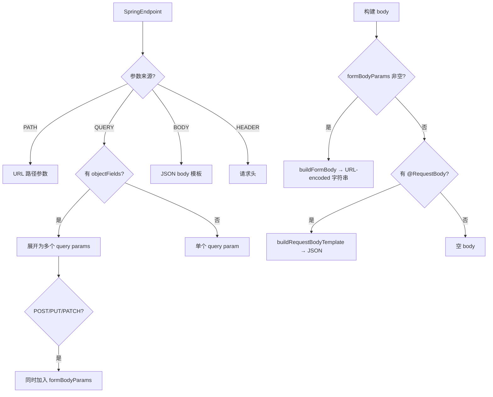

# 研究发现：请求数据生成优化

> ⚠️ 已过时（2026-08-31，Hoppscotch→MyHope 改造已完成），内容仅供历史参考。

## 分析背景

从专业 HTTP 测试角度审查 `HoppscotchDataConverter.toHoppscotchRequest()` 生成的请求数据，找出与 Hoppscotch 预期格式 / 真实 Spring Boot 行为之间的差距。

## 当前实现全景

### 已覆盖的

| 维度 | 行为 |
|---|---|
| HTTP Method + 路径 | 完整生成 |
| 路径变量 | 从 `{id}` 模板提取为 params |
| `@RequestParam` → URL query params | `?key=value` |
| 无注解 POJO → 展开为 query params | 递归展开字段 |
| 无注解 POJO (POST/PUT/PATCH) | query params + form body 双支持（刚修复） |
| `@RequestBody` → JSON body | 递归类型推导，生成占位 JSON 模板 |
| `@RequestHeader` → headers | 正确传值 |
| `consumes` → Content-Type header | 正确设置 |
| Swagger/Knife4j 描述 | 提取为请求名称 |
| RequestValidator | 发送前校验 JSON 格式合规 |

### `toHoppscotchRequest()` 关键决策点



## 缺失项分析

### P0-1: 路径变量缺占位值

**文件**：`HoppscotchDataConverter.toHoppscotchRequest()` 行 118-132

```kotlin
// 当前：所有 value = ""
params.add(HoppscotchParam(key = paramName, value = "", active = true))
// 期望：根据 paramType 生成合理占位
```

但有一个问题：当前路径参数循环中并没有用到 `endpoint.parameters` 里的类型信息（只用了 `name`）。`SpringControllerParser` 解析时已经拿到了每个参数的类型（`endpointParam.type`），但在这段代码中只检查了 `defaultValue`，没有依据类型派生占位值。

**解决方案**：引入一个类型→占位值映射函数（`buildRequestBodyTemplate` 已有类似的类型判断逻辑，可提取复用）：
- `int`/`Integer`/`long`/`Long` → `"0"` / `"1"`
- `String` → 参数名本身（如 `"userId"`）
- `boolean`/`Boolean` → `"true"`
- `UUID` → UUID 格式占位
- 其他 → 参数名

### P0-2: MultipartFile / 文件上传未支持

**涉及文件**：
- `SpringControllerParser.parseSingleParameter()` (484-554) — 未识别 `MultipartFile`
- `HoppscotchDataConverter.toHoppscotchRequest()` (134-170) — 未特殊处理
- `HoppscotchDataConverter.buildFormBody()` (300-306) — multipart 格式错误
- `RequestValidator` (128-132) — 明确指出 multipart body 应为数组

**当前行为**：`MultipartFile file` → 无 Spring 注解 → QUERY + `objectFields=[]` → `?file=`

**期望行为**：
1. 解析时识别 `MultipartFile` / `org.springframework.web.multipart.MultipartFile`
2. 标记参数来源（可设新 `ParamSource.FILE` 或复用于 `ParamSource.QUERY` + 额外标记）
3. 生成 multipart/form-data body（Hoppscotch 预期为 JSON 数组 `[{key, value, type}]`）

**检测策略**：在 `parseSingleParameter()` 中，当未匹配到 Spring 注解时，检查参数类型是否为 `MultipartFile`（完整类名或简名匹配）。

### P1-1: multipart/form-data body 格式错误

**文件**：`HoppscotchDataConverter.buildFormBody()` (300-306)

```kotlin
// 当前：对任何 form 类型都生成 URL-encoded 字符串
val body = formParams.joinToString("&") { ep ->
    "${ep.name}=${ep.value}"
}

// Hoppscotch 期望：
// - application/x-www-form-urlencoded → body = "key=value&k2=v2" (字符串) ✅
// - multipart/form-data → body = [{key:"file", value:"", type:"file"}] (数组) ❌
```

注意 `buildFormBody` 签名为 `contentType: String?`，已经能拿到 Content-Type。据此分支输出不同格式即可。

同时 `HoppscotchBody` 的 `body` 字段是 `String?`，所以 multipart 数组需要序列化为 JSON 字符串存入。

### P1-2: 参数类型感知的默认值

**涉及文件**：`HoppscotchDataConverter.toHoppscotchRequest()` — query params 循环 (134-170)

当前所有 query param 的 value 都是 `""`，包括数值型和布尔型参数。`@RequestParam int count` → `?count=`（不好用）。

**解决方案**：对简单类型使用 `EndpointParameter.type` 派生默认值：
- 数值类型 → `"0"`
- 布尔 → `"true"`
- 字符串 → `""` （保持现状）

`buildRequestBodyTemplate` 已有 `typeHint in listOf(...)` 映射，抽成工具函数复用。

### P1-3: 路径变量参数类型未正确传递（隐含问题）

当前路径参数循环只用了 `endpoint.parameters.find { it.name == paramName && it.source == ParamSource.PATH }` 来找到参数。如果找不到（路径中有 `{id}` 但参数列表中无对应 PATH 参数），则直接 `HoppscotchParam(key = paramName, value = "")`。这个回退路径中，参数类型信息缺失了。

需要确保路径变量一定有对应的 `EndpointParameter`，以便获取 `type` 信息来决定占位值。

## Hoppscotch 请求数据模型参考

```kotlin
data class HoppscotchBody(
    val contentType: String? = null,   // 如 "application/json", "application/x-www-form-urlencoded", "multipart/form-data"
    val body: String? = null           // JSON 字符串 / URL-encoded 字符串 / 序列化后的数组
)

data class HoppscotchRequest(
    val v: String = "17",
    val name: String,
    val method: String,
    val endpoint: String,
    val params: List<HoppscotchParam> = emptyList(),
    val headers: List<HoppscotchHeader> = emptyList(),
    val body: HoppscotchBody = HoppscotchBody(),
    val auth: HoppscotchAuth = HoppscotchAuth(),       // 暂未用到
    val preRequestScript: String = "",                   // 暂未用到
    val testScript: String = "",                         // 暂未用到
    val requestVariables: List<HoppscotchVariable> = emptyList(),  // 暂未用到
    val responses: Map<String, Any> = emptyMap()         // 暂未用到
)
```

**注意**：`body` 字段是 `String?`，所以 multipart 数组需序列化为 JSON 字符串传入。
